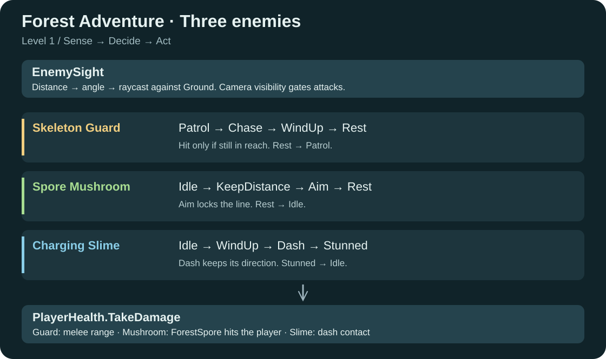

# Assignment 10 — Three Enemy Types

Play → Level1. Собери четыре монеты и дойди до выхода справа. Джойстик двигает персонажа, Jump позволяет перепрыгнуть врага и укрытие. Чтобы повторить попытку, используй Restart в меню паузы.

## Карта скриптов для видео

| Кто | Состояния и правила | Как избежать урона |
|---|---|---|
| Skeleton Guard / ForestGuard | Patrol между двумя точками → Chase при обнаружении → WindUp в радиусе удара → Rest. Потерял игрока — возвращается на маршрут. | При красном предупреждении отойди дальше 1,25 или спрячься за укрытием. |
| Spore Mushroom / ForestShooter | Idle → KeepDistance → Aim → Rest. В начале Aim фиксирует линию, через 0,65 с выпускает ForestSpore. | Перепрыгни линию после начала прицеливания. Спора летит прямо и разбивается о платформы. |
| Charging Slime / ForestCharger | Idle → WindUp при обнаружении на похожей высоте → Dash до точки или стены → Stunned. | Прыгни во время красного предупреждения. В рывке слизень не меняет цель. |

Все трое используют EnemySight: расстояние → угол → Physics2D.Raycast по Ground. Слой Ground здесь включает платформы и укрытие. Камера и игрок заданы в сцене. Урон передаётся в существующий PlayerHealth.TakeDamage. Красный цвет — готовится атака; голубой — враг восстанавливается. Диапазоны и задержки находятся на объектах Forest encounter в Inspector.

## Проверка на телефоне

Дай телефон двум людям, которые ещё не видели уровень. Без подсказок посчитай попытки от старта до выхода. Цель: 2–4. Запиши обоих на видео (1–2 мин). Ниже пустые поля для настоящих результатов.

| Тестер | Попыток до выхода | Где потерял здоровье / что не прочитал |
|---|---:|---|
| 1 | | |
| 2 | | |

Меняй по одному параметру за раз. Запиши фактически выбранные параметры, прежнее и новое значения, причину и повторный результат.

| Параметр (враг) | Было | Стало | Наблюдение и результат |
|---|---:|---:|---|
| | | | |
| | | | |

## План английского видео (2–3 мин)

- Show Level1 on the phone. Explain the goal and the controls.
- Show the guard seeing the player, then losing sight behind cover.
- Show the mushroom's aim line and dodge its shot. Bait the slime's dash and pass during its recovery.
- Draw the three state sequences above. Explain EnemySight → enemy state → PlayerHealth, and ForestShooter → ForestSpore.
- Show the two actual tuning changes and report both testers' attempts. Record in your own voice and save as MP4.
